<p align="center">
  
</p>

<h1 align="center">Fivebar</h1>

<p align="center"><b>Five checks before every push.</b><br>
Fivebar scans what your coding agent changes, hands the problems back to the agent to fix, and stops pushes that still carry critical or high findings.</p>

<p align="center">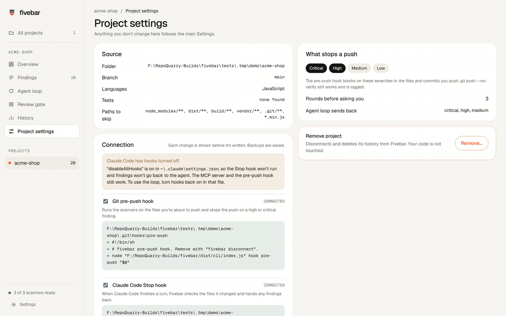</p>

Coding agents write code faster than anyone reads it. Fivebar sits between the agent and `git push`. It runs three open source scanners on every change, merges their results, and talks to the agent directly, so the agent fixes its own mistakes before you ever see them.

Everything runs on your PC. There's no Fivebar server, no account and no API key. The AI parts use the `claude` command you already have.

## What it does

- **Scans every change** with Opengrep, Gitleaks and OSV-Scanner, then merges the results so one problem shows up once, with a badge for each tool that found it.
- **Sends findings back to the agent.** When Claude Code finishes a turn, a Stop hook scans the files it touched. Anything at critical, high or medium goes straight back to the agent with the file, the line and a suggested fix. Up to 3 rounds, then Fivebar asks you.
- **Guards `git push`.** A pre-push hook scans the files and the commits in the push. A key added in one commit and deleted in the next still gets caught.
- **Gives the agent tools.** An MCP server lets Claude Code list findings, ask for detail, re-scan and mark a fix, which only counts after a clean re-scan.
- **Runs a review gate.** One AI review scores the latest change 1 to 5 on security, correctness, readability, tests and maintainability. All five have to be 5. Your tests and the scanners set limits the AI can't score above.
- **Shows it all in a desktop app**, with a score per project, a findings list, the agent loop round by round, and a history of every scan, push and review.

## How the loop works

1. You ask Claude Code for a change, as usual.
2. Claude Code finishes its turn. The Stop hook runs `fivebar hook stop`.
3. Fivebar scans only the files the agent changed. On a small project this takes 2 to 3 seconds.
4. If it finds problems, it blocks the stop and hands Claude Code a message like this one, taken from a real run:

```text
fivebar · security check · round 1 of 3
3 problems in the files you changed. Fix each one, then finish your turn and Fivebar re-checks.

1. HIGH eval() runs any string as code
   where: src/users.js:16 (CWE-95)
   fix:   Replace eval with JSON.parse for data, or a lookup table for known actions.
   id:    3cfaeb0b9ef5  (found by opengrep)
2. MEDIUM Setting innerHTML from a variable can run injected scripts (XSS)
   where: src/users.js:12 (CWE-79)
   ...
If one of these is a false positive, say so in your reply and leave it. The owner can dismiss it in Fivebar.
```

5. Claude Code fixes them in the same session and finishes again. Fivebar re-checks, closes what's fixed and marks the loop as passed.
6. After 3 rounds with problems still open, Fivebar stops blocking, shows you a message that nothing was pushed, and marks the loop "needs you".

In testing, we asked Claude Code for one small function in a file that already had three problems. Every run took one round and between 40 and 52 seconds from prompt to pass. The project score went from 28 to 51.

## A tour of the app

### Set up in six steps

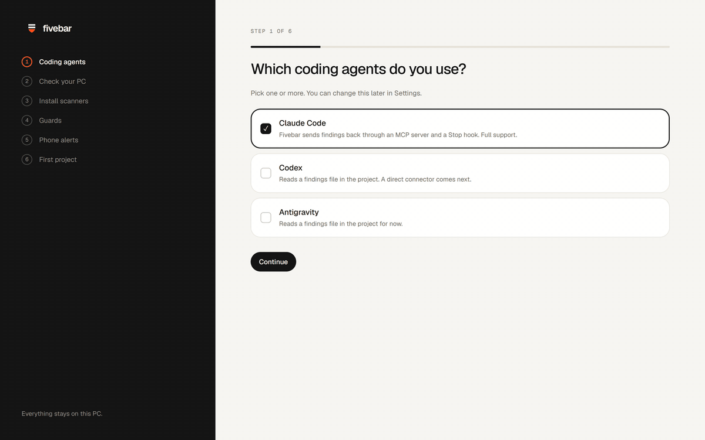

One job per screen: pick your coding agents (Claude Code, Codex, Antigravity, or all three), check your PC for git and Claude Code, install the scanners, then add your first project. The first scan of the demo project found 10 problems in 2.6 seconds.

### Overview

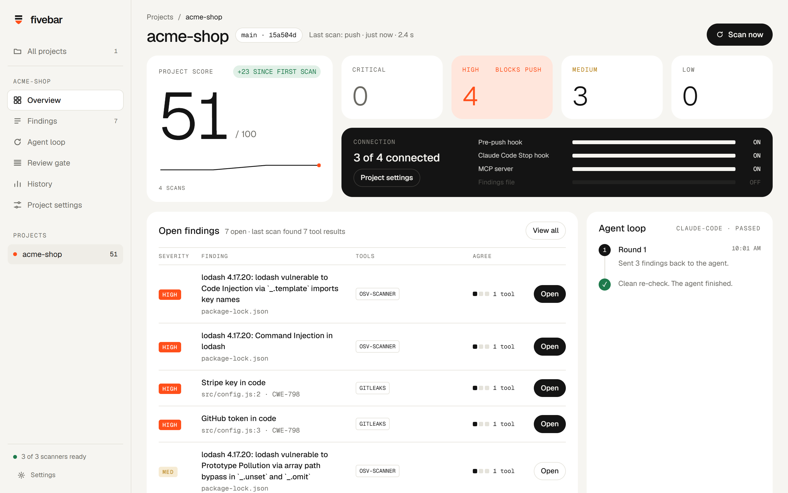

A score out of 100, open findings by severity, what's connected, and the latest agent loop. The high tile carries a "blocks push" label because the pre-push hook stops on high and critical findings.

### Connect, with every change shown first

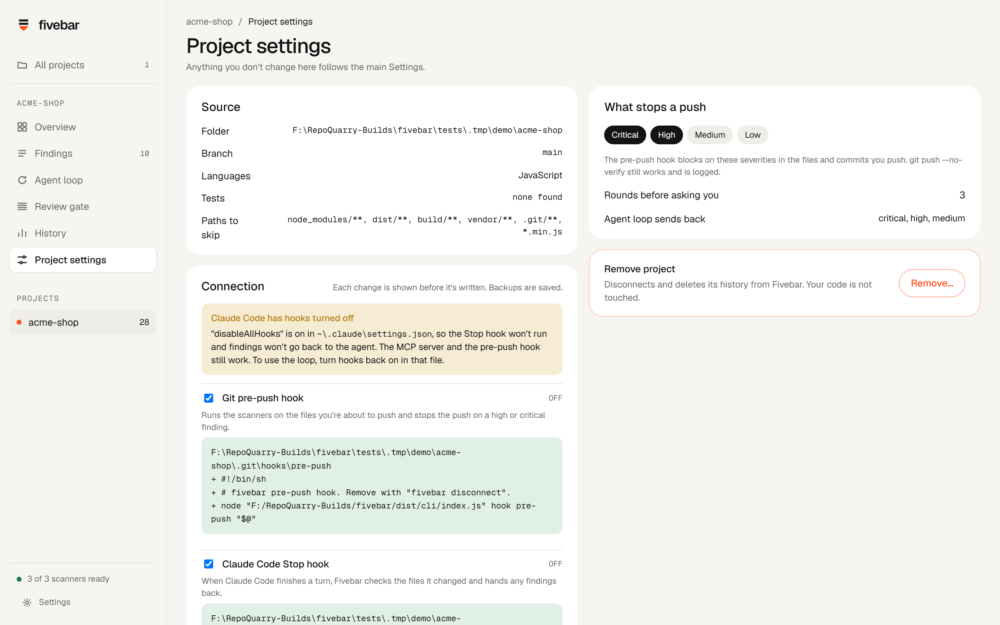

Nothing in your project changes until you press Connect. The screen shows every line Fivebar will write, file by file. Any file it changes gets a backup first, and Disconnect puts everything back. If Claude Code has hooks switched off, a warning says so here (more on that below).

### The agent loop, live

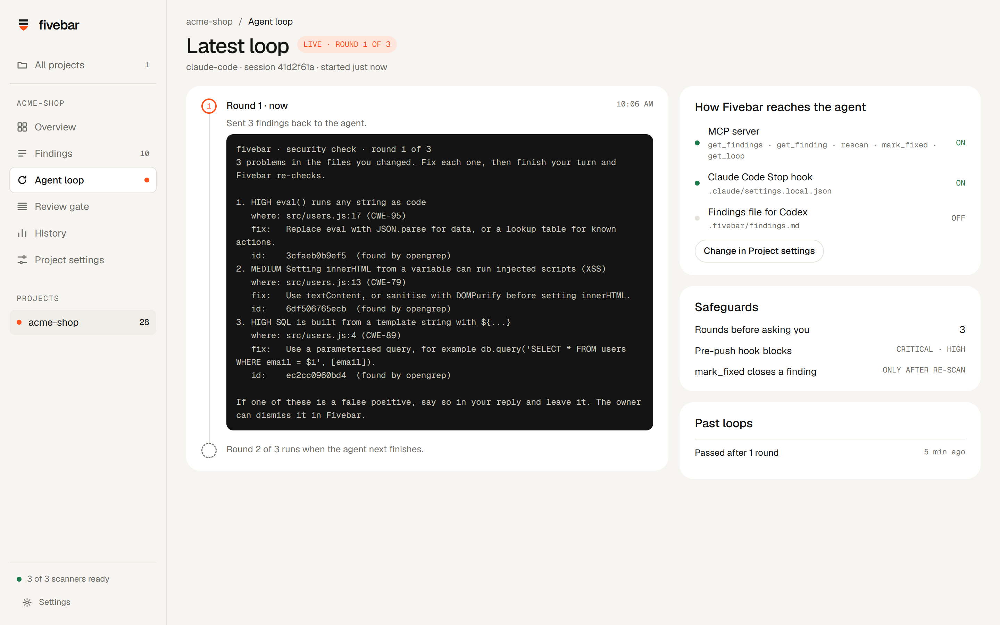

The page shows each round, the exact message the agent received, and how Fivebar reaches the agent.

### Findings

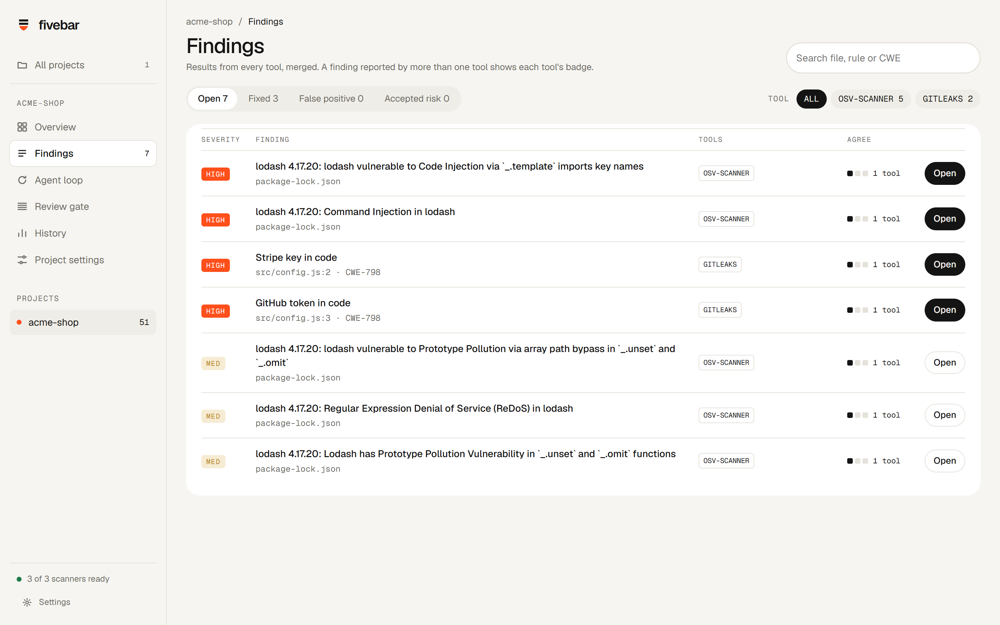

Every finding from every tool, merged. Filter by status or tool, or search by file, rule or CWE.

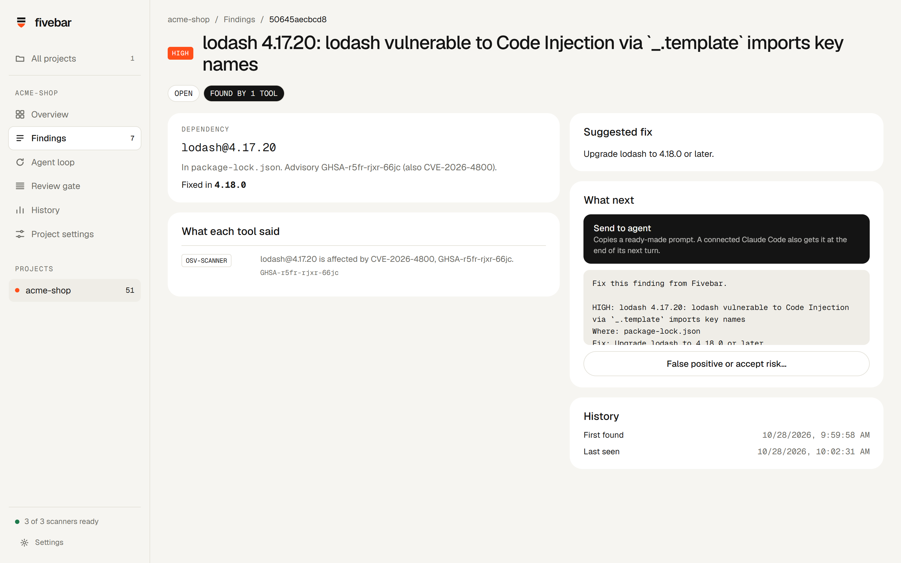

Each finding has the suggested fix, what each tool said, and a ready-made prompt to copy to any agent. Marking a false positive or accepting a risk needs a reason. Accepted risks come back after 30 days.

### Review gate

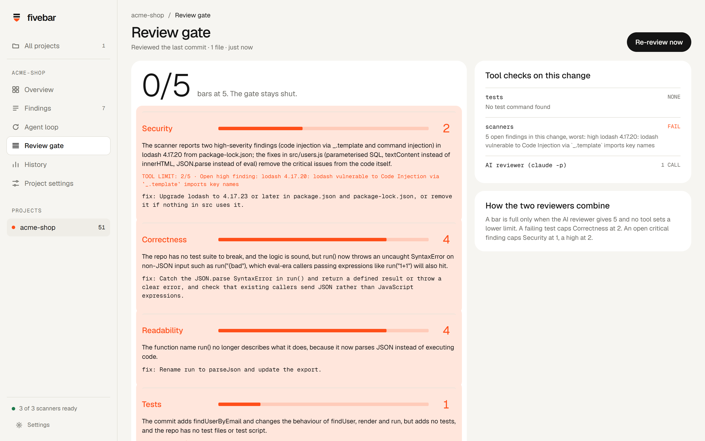

The gate reviewed the demo fix above and kept the gate shut at 0 of 5. It also caught a real regression: the agent had swapped `eval` for `JSON.parse`, so any caller still passing an expression like `run("1+1")` now gets an error.

### History and settings

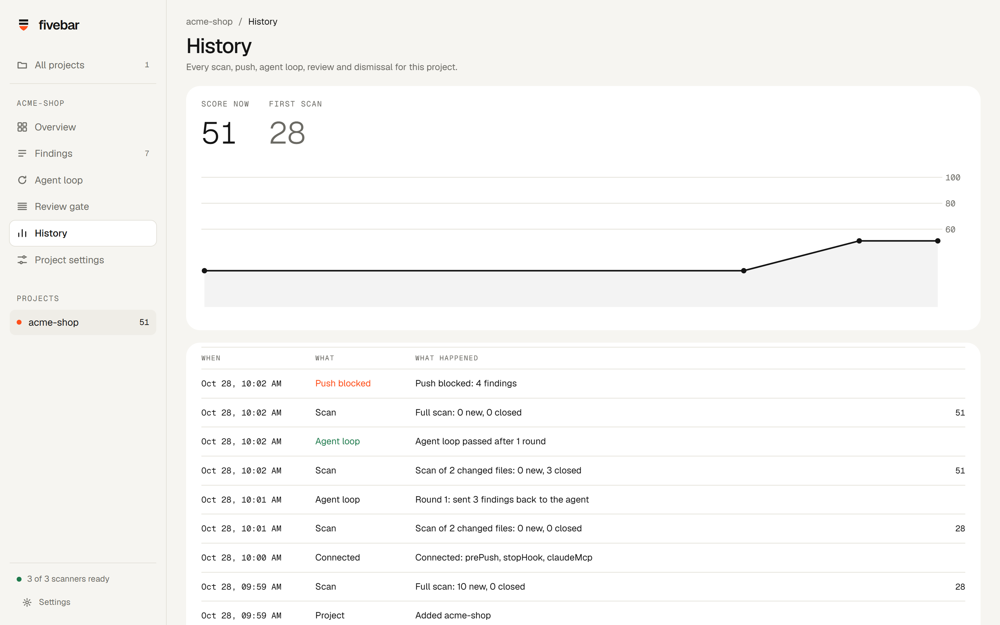

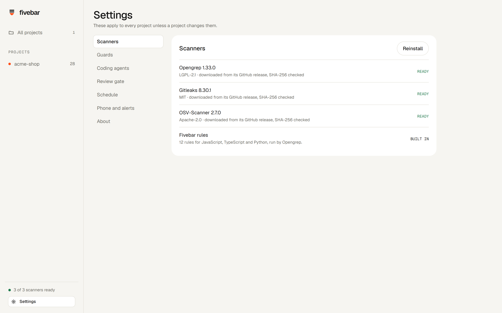

The app follows your Windows light or dark theme.

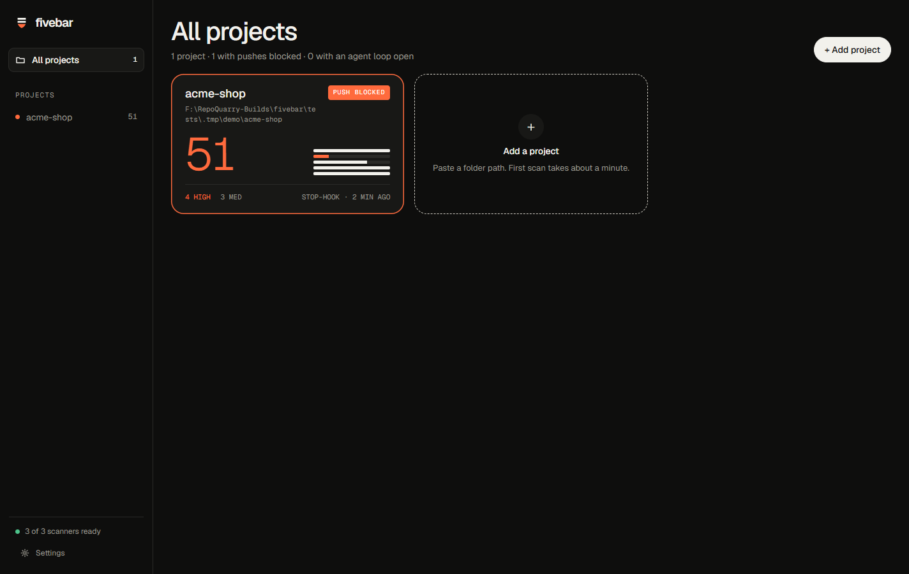

## Requirements

- Windows 10 or 11. Fivebar is built and tested on Windows 11.
- Git, for the pre-push hook.
- Claude Code, for the agent loop, the MCP server and the review gate. Scanning and the push guard work without it.
- Node.js 20 or later, only if you run from source.

## Install

Download `Fivebar-Setup-0.1.0.exe` from the [latest release](https://github.com/Obiwayne/fivebar/releases/latest) and run it. It installs for your Windows user only, so it needs no admin rights, and adds Start menu and desktop shortcuts. The setup wizard then downloads the scanners.

The installer isn't code-signed yet, so Windows SmartScreen may say it "protected your PC". Choose More info, then Run anyway. Uninstall from Settings, Apps. Your projects and findings stay in `%APPDATA%\Fivebar` until you delete that folder.

The installed app needs no Node: the hooks and the MCP server run Fivebar's CLI through the app's own `Fivebar.exe`.

## Run from source

```bash
npm install
npm run build
node dist/cli/index.js tools install
npm run app
```

`npm run dist` builds the installer into `release/`.

`tools install` downloads Opengrep, Gitleaks and OSV-Scanner from their GitHub releases, about 120 MB in total, and checks each file against a SHA-256 pinned in the code before it ever runs. The setup wizard in the app does the same thing if you skip this step.

The app lives in the tray. Closing the window hides it, and Quit is in the tray menu.

## Connecting a project

Connect has four parts. You pick which ones you want.

| Part | What Fivebar writes | What it's for |
| --- | --- | --- |
| Git pre-push hook | `.git/hooks/pre-push` | Scans each push. An existing hook is saved as `pre-push.fivebar-bak` first. |
| Claude Code Stop hook | `.claude/settings.local.json` | Runs the agent loop at the end of each Claude Code turn. |
| Claude Code MCP server | `claude mcp add --scope local fivebar` | Gives the agent the five Fivebar tools. Local scope, so it stays on your machine. |
| Findings file | `.fivebar/findings.md`, added to `.git/info/exclude` | A plain list of open findings for Codex, Antigravity or any other agent to read. |

None of these files get committed. `settings.local.json` and the local MCP scope are personal to you, and `.fivebar/` is excluded from git.

### If the agent loop doesn't run

Claude Code skips every hook when `"disableAllHooks": true` is set in any of its settings files. Fivebar still shows the Stop hook as connected, because the hook is in place, but Claude Code never calls it. Fivebar checks for this and shows a warning on the Connect screen with the file that switches hooks off. The MCP server and the push guard keep working either way.

## The push guard

- Scans the files in the push and the commit range being pushed, so secrets deleted in a later commit still count.
- Blocks on critical and high findings by default. You change this per project in Project settings.
- Prints each blocking finding with its file and line. On the demo project it stopped a push with 4 high findings in 2.7 seconds.
- Never breaks your push because Fivebar itself failed. If the scan errors or takes longer than 60 seconds, the push goes through with a warning.
- `git push --no-verify` skips the check, as with any git hook, and Fivebar has no record of it.

## The review gate

Press Review in the app, or run `node dist/cli/index.js review <folder>`. Fivebar reviews your uncommitted changes, or the last commit when there are none.

- Your project's test command runs first, when Fivebar finds one.
- One `claude -p` call scores the change against a written rubric, with read-only tools (Read, Grep, Glob). A score of 4 must name one specific thing to fix.
- Hard limits apply on top. A failing test caps correctness at 2. An open critical finding caps security at 1, a high at 2 and a medium at 3. No test suite caps tests at 3.
- Dependency advisories count against every change, because every change ships with them.

A review takes about 20 to 30 seconds and uses one Claude job from your plan.

## The score

Each project starts at 100. Every open finding takes points off: 25 for critical, 10 for high, 3 for medium and 1 for low. An accepted risk counts half. The score never drops below 0.

## Scanners

| Tool | Version | Licence | What it checks |
| --- | --- | --- | --- |
| [Opengrep](https://github.com/opengrep/opengrep) | 1.33.0 | LGPL-2.1 | Code patterns, using Fivebar's 12 rules in `rules/fivebar-rules.yml` for JavaScript, TypeScript and Python: SQL built from strings, `eval`, `innerHTML` and `dangerouslySetInnerHTML`, shell commands from templates, open redirects, wildcard CORS, unverified JWTs, `shell=True` and unsafe YAML loads. |
| [Gitleaks](https://github.com/gitleaks/gitleaks) | 8.30.1 | MIT | Secrets in files and in pushed commits. Fivebar shows only the last 4 characters of a secret. |
| [OSV-Scanner](https://github.com/google/osv-scanner) | 2.7.0 | Apache-2.0 | Known advisories for the packages in your lockfiles. |

Fivebar skips folders git ignores (build output, virtualenvs, `node_modules`) plus the skip paths in Project settings. Fivebar runs the scanners as separate programs and doesn't bundle their code.

## Privacy and cost

- Everything stays on your PC. Project data lives in `%APPDATA%\Fivebar` and the scanners in `%LOCALAPPDATA%\Fivebar\tools`.
- The app's window talks to a local API on 127.0.0.1. Each launch makes a new random token, and every request needs it.
- No paid services. The scanners are free and open source. The review gate uses your own Claude Code plan through `claude -p`. The agent loop adds no Claude calls of its own: findings go into the session you're already running.

## Command line

The CLI covers everything the app does.

```text
fivebar tools install           download the scanners (checks SHA-256)
fivebar tools status            show which scanners are installed
fivebar add <folder>            add a project
fivebar scan [folder] [--changed]  scan a project (whole project by default)
fivebar findings [folder]       list open findings
fivebar review [folder] [--no-ai]  run the review gate
fivebar plan [folder]           show what "connect" would change
fivebar connect [folder] [--parts prePush,stopHook,claudeMcp,findingsFile]
fivebar disconnect [folder]     remove the hooks and the MCP server
fivebar status [folder]         show what is connected
fivebar serve [--port 4870]     run the local API and UI in a browser
fivebar mcp --project <folder>  run the MCP server (Claude Code starts this)
fivebar hook stop               Claude Code Stop hook (reads JSON on stdin)
fivebar hook pre-push           git pre-push hook (reads refs on stdin)
```

Run it as `node dist/cli/index.js <command>` after `npm run build`.

## MCP tools

| Tool | What it does |
| --- | --- |
| `get_findings` | Open findings for the project, filtered by severity or file. |
| `get_finding` | One finding in full, with the code and the fix. |
| `rescan` | Scan the changed files, or the whole project, now. |
| `mark_fixed` | Close a finding. It closes only if a fresh scan no longer finds it. |
| `get_loop` | The state of the current agent loop. |

## Tested on

- **The demo shop** in `tests/fixtures/vuln-app`, a made-up app with its problems planted on purpose: 10 findings on the first scan, the full agent loop with Claude Code three times, a blocked push and a review.
- **The installed app** (0.1.0) on a fresh copy of the demo shop: scan, blocked push, MCP server and the agent loop.

`docs/build-log/build-story.md` tells the story of the build, including the bugs testing turned up and how each got fixed.

## Project layout

```text
src/core/       scanners, merging, scoring, git, hooks, connect, review, storage
src/cli/        the fivebar command
src/mcp/        the MCP server
src/server/     the local HTTP API
src/app/        Electron main process and the React UI
rules/          Fivebar's Opengrep rules
tests/          unit tests and the vulnerable demo app
scripts/        build-log screenshots and icon rendering
docs/build-log/ build story, screenshots, GIFs and capture plans
```

## Development

```bash
npm test            # vitest
npm run typecheck   # tsc
npm run dev:ui      # UI on port 4871, API proxied to 4870
npm run serve       # local API and built UI on port 4870
```

`scripts/capture.mjs` drives the real UI and saves screenshots at 2880 × 1800 from a plan in `docs/build-log/plans/`. `scripts/render-icons.mjs` renders the app and tray icons from `assets/icon.svg`.

Storage uses sql.js, SQLite compiled to WebAssembly, so there's nothing native to compile. A lock file keeps the app, the hooks and the MCP server from writing at the same time.

## What's next

Built and tested today: setup, the three scanners, merging and scoring, the Claude Code agent loop, the push guard, the MCP server, the review gate, every screen of the desktop app, and the tray.

Coming next:

- **Guards** that stop risky commands inside the agent before they run, such as `rm -rf`, force pushes and writes outside the project.
- **AI audits** with community security skills, and fixes for what they find.
- **A nightly scan**, since new advisories land on code nobody touched.
- **A phone app** over your own Tailscale network, for watching the loop and getting told when it needs you.
- **Direct connectors for Codex and Antigravity.** Today they read `.fivebar/findings.md`.
- **An installer.**

## Contributing

Fivebar is open source under Apache-2.0 and open to contributors. Good first areas: new Opengrep rules in `rules/fivebar-rules.yml` with a test in `tests/fixtures`, false positives you hit on real projects, and connectors for other coding agents. Please open an issue before a large change.

## Licence

Fivebar is licensed under the [Apache License 2.0](LICENSE). You're free to use, change and share it, including in commercial work, as long as you keep the copyright and [NOTICE](NOTICE) and mark the files you change. Contributions are accepted under the same licence. The licence gives no rights to the Fivebar name or logo.

The scanners keep their own licences, listed above. Fivebar runs them as separate programs and doesn't bundle their code.
